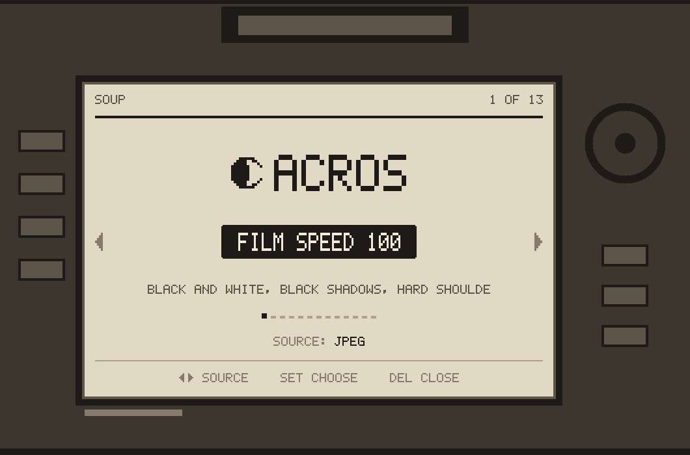
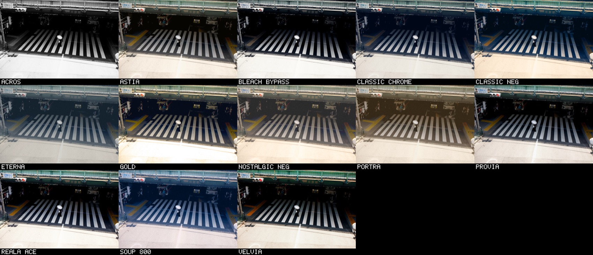

<div align="center">

# 🎞️ Soup Engine <sub><sup>beta</sup></sub>

### Film looks, in the camera, on several Canon EOS bodies.

<br>



<br>
<br>

`beta` &nbsp;·&nbsp; `GPL v2` &nbsp;·&nbsp; `13 film stocks`

</div>

<br>

The same look engine runs on every supported body. You install a **zip for
your camera** — no compiler, no build steps.

| Camera | Firmware | Download | After install |
|:--|:--|:--|:--|
| EOS 5D Classic | 1.1.1 | `…-5DC.111.zip` | Trash-button picker |
| EOS 50D | 1.0.9 | `…-50D.109.zip` | Magic Lantern **Film** page |
| EOS 6D Mark I | 1.1.6 | `…-6D.116.zip` | Magic Lantern **Film** page |
| EOS 5D Mark III | **1.2.3** | `…-5D3.123.zip` | Magic Lantern **Film** page |
| EOS 550D | 1.0.9 | `…-550D.109.zip` | Magic Lantern **Film** page |

```
# 5D Classic
IMG_1234.CR2        your raw file, untouched
IMG_1234.FLM.JPG    the same photo with the look on it

# 50D / 6D / 5D Mark III
IMG_1234.CR2        your raw file (preview updated when Delete CR2 is off)
FLM_1234.JPG        the same photo with the look on it
```

<br>



<div align="center"><sub>
All thirteen, one frame, straight off the card.
</sub></div>

<br>

> ⚠️ **Beta.** Unofficial code on old cameras. It's easy to remove.
> Only the firmwares in the table above are in scope. Other bodies and
> firmware versions are not.

> ⚖️ **No warranty.** Like all GPL software this comes with none. You
> install it at your own risk. See sections 11 and 12 of the
> [licence](LICENSE).

> 🎨 **The looks are still being tweaked** and will keep changing. The
> names are shorthand inspired by those films — original designs, not
> exact copies or licensed emulations. All trademarks belong to their
> owners. Soup Engine is **not affiliated with** Canon, Fujifilm, Kodak,
> Adobe, or Magic Lantern.

<br>

---

<br>

## 📦 Installing

You need three things: the **right Canon firmware**, **stock Magic Lantern**
for that body, and the **Soup Engine zip** for that body.

> ### 👉 [Download the latest release](https://github.com/rebelt2i/soup-engine/releases/latest)
>
> Pick the zip whose name ends with your platform (`5DC.111`, `50D.109`,
> `6D.116`, `5D3.123`, or `550D.109`). Each zip has a short `INSTALL.txt` inside.

<br>

### Shared steps (every camera)

#### 1️⃣ &nbsp; Install stock Magic Lantern first

| Camera | Magic Lantern page |
|:--|:--|
| 5D Classic | [5DC.html](https://builds.magiclantern.fm/5DC.html) |
| 50D | [50D.html](https://builds.magiclantern.fm/50D.html) |
| 6D Mark I | [6D.html](https://builds.magiclantern.fm/6D.html) |
| 5D Mark III | [5D3.html](https://builds.magiclantern.fm/5D3.html) |

Follow their instructions. Confirm the camera starts and the Magic Lantern
menu opens before going further. Soup Engine never touches the camera's
boot flag; their installer does that.

<br>

#### 2️⃣ &nbsp; Back up the stock files

Copy off the card and keep somewhere safe:

- **Every body:** `AUTOEXEC.BIN`
- **50D / 6D / 5D Mark III also:** `ML/modules/50D_109.sym`,
  `ML/modules/6D_116.sym`, or `ML/modules/5D3_123.sym` (whichever matches)

Putting those back is how you uninstall.

<br>

#### 3️⃣ &nbsp; Unzip Soup Engine onto the card

Open the zip for your camera. Copy everything to the **root** of the card
(same place as `AUTOEXEC.BIN`). Replace files when asked.

<br>

#### ✅ &nbsp; Put the card in and switch the camera on

| Family | What to do |
|:--|:--|
| **5D Classic** | Nothing to enable. Press the **trash button** for the film picker. |
| **50D / 6D / 5D Mark III** | Open the Magic Lantern menu. The **Film** page is the `F` tab. Turn **Film** on. Leave **Delete CR2** off until you have seen a picture you like. |

<br>

> ### ⚠️ Set your Picture Style to Standard, Neutral or Faithful
>
> On Monochrome every look comes out black and white.

<br>

<details>
<summary><strong>5D Classic — note about the Magic Lantern menu</strong></summary>

<br>

While Soup Engine is installed you won't have Magic Lantern's own menu,
since this replaces the file that provides it. Put their `AUTOEXEC.BIN`
back whenever you want it again.

</details>

<br>

---

<br>

## 📷 Using it

<br>

### 5D Classic

Press the **trash button** and the picker fills the screen.

| button | what it does |
|:--|:--|
| 🎛️ **Wheel** | choose a film |
| ↕️ **Up / Down** | choose where the look comes from |
| ✅ **`SET`** | pick that film and close |
| 🗑️ **Trash** | close, changing nothing |

Your choice survives switching the camera off.

Each photo takes about twenty seconds to develop. You can keep shooting
while it works, and the screen shows `FRAME 2 OF 3` when there's a
queue.

**`SOURCE: JPEG`** is the default. Use this.

**`SOURCE: RAW`** works from the sensor data instead. It takes minutes
rather than seconds, some colour adjustments can't be applied, and
`ACROS` won't be black and white.

`FILM SPEED 50` on the picker is only a label. It does not change your
camera's ISO.

Your raw files are never modified. Delete the JPEG and the photo is
exactly as the camera shot it.

<br>

### 50D / 6D / 5D Mark III

On the **Film** page:

| row | what it does |
|:--|:--|
| **Film** | off leaves every file alone. On develops each new raw. |
| **Delete CR2** | off keeps the raw. On deletes it only after `FLM_nnnn.JPG` exists. |
| **Stock** | the look. The wheel changes it. |

The choice is written to `ML/SE.CFG` and survives switching the camera off.

Take a photo. The screen shows `FILM ACROS 43,71%` until the JPEG is
finished. You can keep shooting while it works. When the box goes away,
open playback on that shot: with **Delete CR2** off, the raw's preview is
already the look. `FLM_1234.JPG` is the same picture as its own file.

The look is applied to the JPEG preview Canon already embedded in the
raw, not to the sensor data. That is why a monochrome picture style
comes out black and white: the preview arrives with no colour left.

<br>

---

<br>

## 🎞️ The films

Thirteen, still under development.

They're small text files in `ML/FILM` on the card, so you can read them,
change them, or write your own. The camera lists whatever it finds
there.

<br>

<div align="center">

### 🎨 [Soup Stocks](https://jiijii0.github.io/soup-stocks/)

**A web editor for the film stocks.**

Drop in a photo, move sliders, download a `.fs`, put it on the card.

The preview is this engine's own code compiled to WebAssembly, so it
matches what the camera writes.<br>Your photo never leaves your browser.

</div>

<br>

---

<br>

## 🧹 Removing it

<br>

### 5D Classic

Put Magic Lantern's original `AUTOEXEC.BIN` back. That's all.

To pause it without uninstalling, delete `SE.BIN`. The camera boots
normally without it.

> 🆘 **If the camera ever misbehaves:** pull the battery, put the card
> in a computer, delete `SE.BIN`. Don't delete `AUTOEXEC.BIN` while the
> boot flag is on, because with the flag set and no `AUTOEXEC.BIN` the
> camera won't start at all.

<br>

### 50D / 6D / 5D Mark III

Put Magic Lantern's original `AUTOEXEC.BIN` back, and put a matching
`ML/modules/<MODEL>_<FW>.sym` beside it. These bodies do not boot
`SE.BIN`; deleting that file does not uninstall the Film page.

> 🆘 **If the camera ever misbehaves:** pull the battery, put the card
> in a computer, restore stock Magic Lantern's `AUTOEXEC.BIN` and
> matching `.sym`. Don't delete `AUTOEXEC.BIN` while the boot flag is on.

<br>

---

<br>

## ❤️ Thanks

This wouldn't exist without [Magic Lantern](https://magiclantern.fm).

Soup Engine runs inside their work. Their builds are what let the cameras
run any of this, and years of their reverse engineering made it possible
to understand. They're worth supporting.

Soup Engine isn't their project, so please don't take problems with it
to them. Open an issue here instead.

<br>

## 📄 Source, building, licence

All of it is in [`src/`](src). Day-to-day install is the release zips
above — you do not need to build.

Developers: see [`docs/guides/build-from-source.md`](docs/guides/build-from-source.md),
[`docs/system/onboarding.md`](docs/system/onboarding.md), and [`src/README.md`](src/README.md).
Agent / AI entry: [`AGENTS.md`](AGENTS.md).

Notices for Magic Lantern, JPEG algorithms, and trademarks:
[`NOTICE`](NOTICE).

GPL v2. See [LICENSE](LICENSE). Distributed **without any warranty**,
including the implied warranties of merchantability and fitness for a
particular purpose (sections 11 and 12).

<br>

<details>
<summary><strong>Experimental / developers</strong></summary>

<br>

**EOS 40D** (firmware 1.1.1) uses the same Classic path as the 5D Classic
but is experimental: no official Magic Lantern zip, card I/O must be
proven, and patch holes may be unconfirmed. There is no user release zip.
See [`src/ml/platforms/40D.111/README.md`](src/ml/platforms/40D.111/README.md).

Why the Classic patch path fails on the 50D:
[`src/ml/platforms/50D.109/PITFALLS.md`](src/ml/platforms/50D.109/PITFALLS.md).

</details>
